<picture>
  <source media="(prefers-color-scheme: dark)" srcset="assets/banner-dark.svg">
  
</picture>

### Hi, I'm Dan.

I've spent nearly 20 years in IT watching good technology fail for boring reasons: nobody adopted it, nobody trusted it, or nobody told the builders what customers were actually saying. I think we're living through one of the most consequential moments in human history, and I'd rather help shape it than watch it. So I build the things I advise on, in **[Icarian Forge](https://www.icarianforge.com)**, my personal AI lab.

### What I've built

| | | |
|---|---|---|
| **[Forge AI Solution Navigator](https://github.com/lautbzehn/ai-solution-navigator)** | A product manager's workspace for taking enterprise AI from pilot to production, with proof. Eight stages grounded in ISO/IEC 22989, NIST AI RMF, and Stage-Gate, with gatekeepers who decide Go, Hold, or Stop. | [Live demo](https://navigator.icarianforge.com) |
| **[The Unlisted](https://github.com/lautbzehn/the-unlisted)** | A hand-picked guide to independent food and drink. An AI research pipeline screened 17,506 venues; a person reviewed every one of the 253 places that made it, for about $70 of research. | [Open the guide](https://unlisted.icarianforge.com) |
| **[The Family Album](https://github.com/lautbzehn/the-family-album)** | A family's handwritten album, nearly a century old, read, translated and researched with Claude into a bilingual book. Published only in anonymized form, with a privacy guard in CI. | [Read the demo](https://www.icarianforge.com/work/the-album/book/) |
| **[icarianforge.com](https://www.icarianforge.com)** | The portfolio itself: case studies, a product video, and the story behind each build. | [Visit](https://www.icarianforge.com) |

### How I work

- **Begin with the person.** Who it's for and why it matters, settled before anyone opens a laptop.
- **Then read the small print.** A strategy only counts once it's delivered. I keep the team pointed at done, and help carry it there.
- **Adoption is the product.** Capability means little until people trust it and use it well. I make sure the builders hear the customer.
- **Keep a human in the loop.** AI drafts, people decide.
- **Use what I recommend.** I don't advise on AI I haven't used myself.

### How I build

I direct AI coding agents as the engineering team: I write the methodology, set the rules up front, make every product call, and nothing ships until I've seen it work in a real browser. Each repository shows the working agreement the agents follow (`AGENTS.md` / `CLAUDE.md`) and the decision records behind the bigger choices.

  
  
  
  
  
  
  

### Learning in public

MIT Professional Education, *Applied Generative AI for Digital Transformation* · Anthropic, *Claude Certified Associate, Foundations* · DeepLearning.AI, *AI For Everyone* · Google, *AI Essentials* · Claude Academy (two courses) · IAPP *AIGP* in progress. Details on my **[résumé](https://www.icarianforge.com/resume/)**.

### Say hello

[LinkedIn](https://www.linkedin.com/in/dan-w-21b8a561/) · hello@icarianforge.com · [icarianforge.com](https://www.icarianforge.com)
